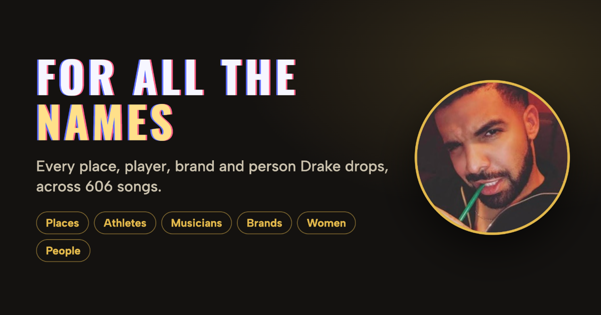
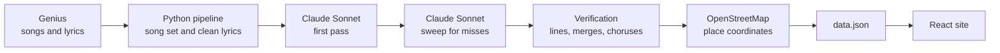

<p align="center">
  <a href="https://for-all-the-names.vercel.app">
    
  </a>
</p>

<h1 align="center">For All The Names</h1>

<p align="center">
  Every name Drake drops, mapped, ranked and linked back to the exact bar.<br>
  <a href="https://for-all-the-names.vercel.app"><strong>Open the live site</strong></a>
</p>

---

For All The Names turns 606 songs of lyrics into a searchable record of Drake's world: the cities, players, cars, labels, rappers, exes and friends he names. Pick a category, click a name, and read every line it appears in.

The places view is inspired by [drizzy.world](https://drizzy.world) by niko draca, which maps every place Drake mentions. This project keeps that idea and adds five more categories.

## What's in it

| Category | Unique names | Mentions | In the most songs |
| --- | ---: | ---: | --- |
| Places | 467 | 1,354 | Toronto (99) |
| Brands | 505 | 1,562 | Mercedes-Benz (61) |
| Musicians | 401 | 1,136 | Lil Wayne (63) |
| Other people | 538 | 941 | God (41) |
| Women | 301 | 479 | Nicki Minaj (11) |
| Athletes & teams | 123 | 229 | Michael Jordan (18) |

The dataset covers 473 of Drake's own songs and 133 guest verses, from 2006 to 2026.

## Features

- **World map** of 464 pinned places, filterable by album.
- **Leaderboards** for every other category, with the album covers each name appears on.
- **Every lyric, one click away.** Each name shows its lines with the song, album and year.
- **Linked lyrics.** Click a highlighted name inside a lyric to jump to that name.
- **Search** across all names.
- **Mentions by year** for each category and place.
- **Features toggle** to include or exclude guest verses.
- **Shareable links.** The current view is stored in the URL.

## How it works



There is no backend. The pipeline produces one static `data.json`, and the site reads it in the browser.

### Teaching the AI to read Drake

Each song goes to Claude Sonnet with its lines numbered and a one-page rulebook. The rulebook defines the categories, says what doesn't count, and spells out common slang. The model returns structured JSON for every occurrence, like this example:

```json
{
  "text": "the 6ix",
  "category": "place",
  "name": "Toronto",
  "kind": "city",
  "line": 14,
  "speaker": "drake",
  "country": "Canada",
  "query": "Toronto, Ontario, Canada"
}
```

Keeping the exact words (`text`) next to the canonical name (`name`) is what lets "the 6ix", "T-Dot" and "Toronto" count as one place while the site still highlights what was actually said.

A keyword search couldn't do this job. "Mike" can mean Michael Jordan in one line and someone else in the next, so the model has to read each name in context.

### Not trusting the AI

An early version of the prompt invented references that weren't in the lyrics, so the output goes through several checks:

1. **Second pass.** A sweep shows the model the lyrics plus everything already found, and asks only for what was missed. It is told not to infer names that aren't written in the line.
2. **Line verification.** Code confirms each quote appears on the line the model cited. If it doesn't, the mention is moved to the right line or marked unverified.
3. **Chorus handling.** Repeats are copied only onto identical lines.
4. **Name merging.** A reviewed list folds variants together, so "Air Jordan" and "Jumpman" both count as Jordan Brand.
5. **Geocoding review.** Places are looked up through Nominatim with a country check, and about a hundred were corrected by hand.

### Running 1,200 AI calls on a subscription

Every song gets two calls, so the job is about 1,200 calls. They run through the headless Claude Code CLI, with four workers in parallel, in batches of 100.

- **Lean calls.** Turning off tools, session history and project settings cuts each call's overhead from about 110,000 tokens to about 1,000.
- **Resumable.** Each song saves to its own file, so a restart skips finished work.
- **Rate-limit aware.** The run stops cleanly at a usage limit instead of failing every remaining song.

## How names are counted

- **Rankings use songs, not raw mentions.** One repeated chorus shouldn't put a name at the top.
- **Lines from featured artists on Drake's songs are included**, and are marked as feature verses. They make up 1,429 of the 5,701 mentions.
- **Guest verses count Drake's sections only.** They cover songs by other artists with at least 100,000 Genius views.
- **Women includes women filed elsewhere**, such as female musicians and athletes, through a separate cross-list.
- **Drake's own names don't count**, including Drizzy, Aubrey and Champagne Papi.
- **A place needs to be identifiable.** "I'm at the W" means W Hotels but names no city, so it stays off the map.

## Known limits

AI extraction is good, not perfect, and this data has rough edges:

- Roughly 250 quotes don't highlight in their lyric line, although the mention is still counted.
- Roughly 40 venues are pinned at city level rather than their exact address.
- Some rarely mentioned names may still have duplicates.
- Song coverage depends on Genius, so unreleased or poorly documented songs may be missing.

Spotted a mistake or a missing name? [Open an issue](https://github.com/rafwan-sarker/ForAllTheNames/issues).

## Run it locally

The processed data is in the repo, so the site runs without the pipeline. You need Node.js 20.19 or newer.

```bash
git clone https://github.com/rafwan-sarker/ForAllTheNames.git
cd ForAllTheNames/web
npm install
npm run dev
```

### Rebuilding the data

The pipeline uses Python 3 with no extra packages. The extraction steps also need the [Claude Code](https://claude.com/claude-code) CLI, signed in, and they use your Claude plan.

Full lyrics are not in this repo, so a rebuild downloads them again. The exact step order is in [AGENTS.md](AGENTS.md). Each step is resumable.

## Project layout

```text
pipeline/   Python steps: songs, lyrics, AI extraction, geocoding, build
data/       Song lists, manual overrides and name merges
web/        Vite + React + TypeScript site
web/public/data.json   The finished dataset the site loads
scripts/verify.sh      Compiles the pipeline and builds the site
```

## Built with

Python, Claude Sonnet, Claude Code, React, TypeScript, Vite, Leaflet, OpenStreetMap and Vercel.

## Credits

- [drizzy.world](https://drizzy.world) by niko draca, the inspiration for the places view.
- [Genius](https://genius.com) for song data and lyrics, with [lyrics.ovh](https://lyrics.ovh) as a fallback.
- [OpenStreetMap](https://www.openstreetmap.org/copyright) contributors for map data and geocoding.

This is an unofficial fan project, not affiliated with Drake, OVO or Genius. Lyrics, album art and other media belong to their respective owners. The repo includes only the individual lines where a name appears, not full lyrics.
